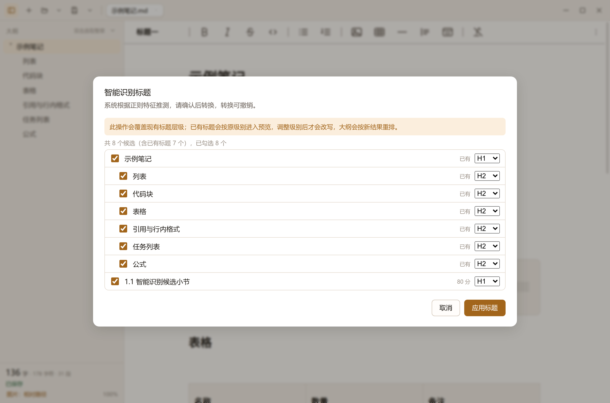
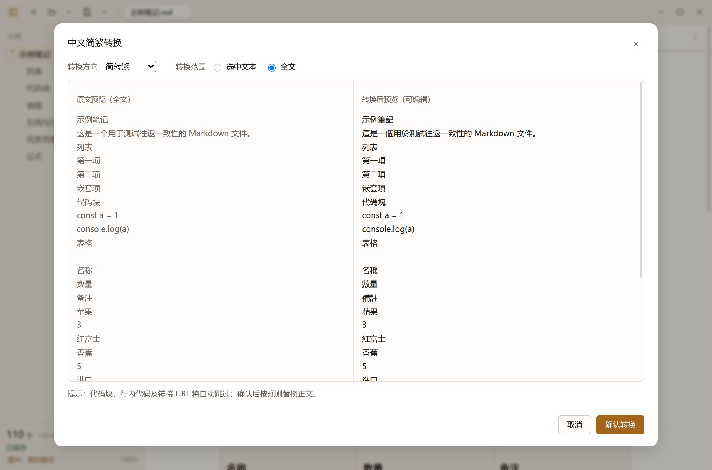

# seekie-write

[](https://github.com/shellexy/seekie-write/releases) [](https://github.com/shellexy/seekie-write/blob/main/LICENSE) 

类 Typora 的所见即所得 Markdown 编辑器。Electron 45 + Milkdown Crepe 7.23。

## 为什么是 seekie-write

* **双击大纲标题**：直接选中整章正文，复制、改写或重排章节更顺手
* **智能识别标题**：繁简章回节、`1.引言`、独立成行的序 / 楔子 / 前言等都能识别；已有标题按原级别预览
* **中文简繁转换**：简转繁 / 繁转简 / 台湾正体 / 香港繁体，代码块与链接 URL 自动跳过，双栏预览同步滚动
* **单文件导出**：Markdown / HTML 导出把图片内嵌为 base64，发给别人不会丢图






## 现在能做什么

* **所见即所得编辑**：Milkdown Crepe 内核，表格 / 代码块（CodeMirror）/ LaTeX 公式（KaTeX，行内 `$…$` 与块级 `$$…$$`）/ 任务列表 / 图片块齐全
* **顶部工具栏**：Crepe TopBar（默认关闭的特性，这里显式打开），纯图标 + 鼠标悬浮提示，分组为
  `段落·标题一~六` │ `粗体 斜体 删除线 行内代码` │ `项目符号 有序列表` │ `插入图片 表格 分割线 引用 代码块` │ `清除格式`；右上角另有浮动 `⋮`
* **右上角 ⋮ 菜单**：浮动在编辑器右上角（视觉上仍是顶栏右侧），包含撤销 / 重做 / 查找 / 替换 / 中文简繁转换 / 查看 Markdown 源码 / 设置 / 关于；不会因窗口变窄被挤到顶栏第二行
* **查看 Markdown 源码**：只读 CodeMirror，Markdown 语法高亮 + 行号，可复制源码
* **自定义标题栏**（Linux 优先，`frame:false`）：新建 / 打开（右侧小箭头展开最近文件）/ 保存 / 另存为·导出下拉、标签条、自绘窗口三键
* **标签条**：用满标题栏剩余宽度；放不下时可用滚轮横向滚动，或 `Ctrl+Tab` / `Ctrl+Shift+Tab` 循环切换，切到的标签会自动滚到可见区域；右侧「全部标签」下拉可直接切换或关闭任意标签
* **启动恢复**：默认只恢复草稿；设置里勾选“启动时恢复上次打开的文件”后，才会连同上次有落盘路径的标签一起重新打开
* **最近文件**：打开按钮旁的箭头列出最近 12 个文件，点一下直接重开；转换文档另存为 Markdown 后，最近文件里的源文件条目会原地替换成保存的 `.md`
* **导出 / 打印**：另存为下拉箭头里包含 另存为、导出 Markdown（单文件）、导出 HTML（单文件）、导出 docx、导出 PDF、打印、打印预览；单文件导出会把图片以内联 base64 写进同一个文件，HTML 里的 LaTeX 公式转成 MathML；docx 导出使用 `@mohtasham/md-to-docx`，代码块启用 lowlight 语法高亮；单行图片按 A4 内容区宽度自适应，高度超出一页时等比缩小；本地/相对/远程图片都会尝试抓取嵌入
* **程序图标**：`build/icon.png` 同时用于窗口图标、Linux 桌面入口和“关于”对话框
* **标签右键菜单**：关闭标签 / 关闭其他标签 / 关闭右侧标签、复制文件路径、在文件夹中显示、重新打开关闭的标签
* **关闭确认**：有未保存改动（包括尚未落盘的草稿标签）时提示 保存 / 不保存 / 取消；转换文档未手动编辑时直接关闭、不提示；编辑过即使草稿已自动保存也会提示；不保存关闭的标签仍可通过右键菜单恢复
* **对话框记忆**：打开 / 保存对话框默认回到上次所在目录
* **大纲底部信息区**：字数 / 选中 / 字符 / 段落 / 保存状态 / 图片策略 / 缩放都收在大纲侧栏底部，不占窗口底部的横向空间
* **查找替换**：`Ctrl+F` / `Ctrl+H` 自动聚焦搜索框；Enter / F3 下一个，Shift+Enter / Shift+F3 上一个；命中项用 ProseMirror Decoration 高亮并自动滚到编辑区中间；到末尾/开头继续搜索会回绕并提示；支持区分大小写、全部替换
* **设置面板**：外观（跟随系统 / 浅色 / 深色）、Crepe 主题（跟随应用 / Frame / Classic / Nord）、正文宽度、字体与字号、打开文档时是否把内嵌图片转成 base64、启动恢复；改完立即生效并持久化
* **中文简繁转换**：⋮ 菜单 → 中文简繁转换；支持简转繁 / 繁转简 / 转台湾正体 / 转香港繁体，选中或全文转换，代码块、行内代码、链接 URL 自动跳过；原文/转换后预览自动增高并共用同一个滚动区域；全文预览只读，选中范围可编辑
* **正文右键菜单**：撤销 / 重做、剪切 / 粘贴、**粘贴为纯文本**、全选、插入图片 / 表格 / 分割线、清除格式、查找 / 替换；选中文字后可复制为纯文本 / Markdown / 富文本；图片上右键可复制图片 / 图片地址
* **可调宽大纲**：拖动右侧分隔条 170–420px，双击恢复 240px，宽度写入设置
* **窄窗口适配**：编辑区变窄时，Crepe 左侧的 +/拖动控件会自动让位，不会被裁到可视范围外
* **多标签页**：一个 ProseMirror view + 多份 EditorState，切标签保留撤销栈、选区、滚动位置
* **文件标签去重**：同一路径（含转换源文件）只保留一个标签，重复打开直接切到已有标签，避免两个标签互相覆盖
* **自动保存**：800ms debounce；只有序列化后的 Markdown 与上次保存不同才写盘，撤销回原内容会清 dirty 并取消自动保存；没有落盘路径的标签只写草稿区（不会弹另存为），关窗口重开能恢复
* **冲突检测**：同一标签保存串行化，mtime 基线随保存结果直接带回，避免自己的自动保存误报；真正的外部修改仍会暂停并提示
* **打开非 Markdown 文档**：`@firecrawl/anydoc` 转换 Office / PDF 等；`@mdgate/html` 转 HTML；纯文本用 `GfmEscape` 转成每行一个段落（不加 `\`、不折叠），源码文件用围栏代码块保留原文；转换文档另存为时默认落在源文件目录；可选把内嵌图片直接转成 base64 data URI，打开即自包含
* **纯文本粘贴**：编辑区普通粘贴和右键“粘贴为纯文本”都会先转成 Markdown（每行一个段落，GfmEscape 转义），代码块内保持原文
* **本地相对图片**：打开的 .md 里 `docs/a.png` 会按文件所在目录解析（`seekie-local://` 协议），dev / AppImage / deb 都能显示，Markdown 源文本仍保持相对路径
* **另存命名**：`季度报告.docx` → `季度报告.docx.md`（保留原扩展名，不覆盖源文件）
* **图片两种保存策略**：内联 base64 / 相对路径（`文档名.assets/`）；base64 保存时先用 `@aurouscia/image-compress` 压成宽度 ≤1280px 的 webp（动图 GIF / webp / SVG 跳过，静态 GIF 会压缩）
* **大纲侧栏**：单击滚动到标题（自动避开 sticky TopBar），**双击选中整章**（大纲底部的"选中字数"立刻变成该章字数）
* **智能识别标题**：大纲顶栏下拉 / 空大纲里的链接 → 智能识别标题；已有标题会按原级别进入预览，新段落按“第X卷/篇/章/回/部/話/话/节/節、一、、1.1、1.引言、序/楔子/前言/後記/附錄/結語”等规则 + 上下文评分并映射 H1–H6；确认后单事务应用，一次 Ctrl+Z 可撤销
* **许可协议**：MIT（见 [LICENSE](LICENSE)）

## 开发

```bash
npm install
npm run dev          # 开发模式（HMR）
npm run build        # 打 out/
npm run typecheck    # 主进程 + 渲染层分别做类型检查
npm run dist         # Linux AppImage + deb
```

打包配置都在 `package.json` 的 `build` 字段（electron-builder 26）：`build/icon.png`、Linux 桌面入口 / MIME、AppImage zstd、`afterPack` 沙箱权限钩子等。`afterPack` 是 electron-builder 的**顶层钩子**，所以放在 `build.afterPack` 而不是 `build.linux.afterPack`。

GitHub Actions（[build.yml](.github/workflows/build.yml)）只在推送 `v*` tag 时触发：构建 deb / AppImage / exe，并自动创建 GitHub Release。普通 commit 不触发构建或发版。Electron 语言包只保留 en-US / zh-CN / ja；deb 实测从 v0.1.4 的约 148 MB 降到约 113 MB。

Linux 上跑无边框窗口需要的系统库：

```bash
sudo apt install libnss3 libatk1.0-0 libatk-bridge2.0-0 libcups2 libgtk-3-0 \
  libxdamage1 libxkbcommon0 libasound2 libatspi2.0-0 libgbm1 libxrandr2 libxcomposite1
```

Wayland 会话下若拖拽区失效，用 `--ozone-platform=wayland` 启动；X11 下直接用默认即可。

## 冒烟测试

需要 Linux + `xvfb-run`：

```bash
npm run smoke        # 先 build，再跑完整冒烟
npm run smoke:only   # 直接用现有 out/ 跑
SMOKE_KEEP=1 npm run smoke:only  # 保留 .smoke 配置便于排查
```

脚本会启动一个随机端口的 Xvfb + Electron，用 CDP 检查：启动文件、重复打开去重、新建空文档、README 相对图片（seekie-local 协议）、撤销回原内容不触发自动保存、真实修改自动保存、智能识别标题（含已有标题）、txt 每行一段、HTML 转换、纯文本粘贴、⋮ 菜单、关于图标等。共 27 项，完成后自动清理 `.smoke/`。

## 快捷键

| 操作               | 快捷键                                       |
| ---------------- | ----------------------------------------- |
| 新建 / 打开 / 保存     | `Ctrl+N` / `Ctrl+O` / `Ctrl+S`            |
| 另存为              | `Ctrl+Shift+S`                            |
| 关闭标签             | `Ctrl+W`                                  |
| 切换标签             | `Ctrl+Tab` / `Ctrl+Shift+Tab`             |
| 撤销 / 重做          | `Ctrl+Z` / `Ctrl+Shift+Z`                 |
| 查找 / 替换          | `Ctrl+F` / `Ctrl+H`                       |
| 设置               | `Ctrl+,`                                  |
| 段落 / 标题一 / 二 / 三 | `Ctrl+0` / `Ctrl+1` / `Ctrl+2` / `Ctrl+3` |
| 清除格式             | `Ctrl+\`                                  |
| 切换侧栏             | `Ctrl+Shift+B`                            |
| 缩放               | `Ctrl+=` / `Ctrl+-` / `Ctrl+Shift+0`      |

## 目录结构

```
electron/
  main.ts              窗口、菜单、IPC、seekie-asset:// 协议、关闭前握手
  preload.ts           contextBridge 白名单（渲染层没有 fs 能力）
  lib/
    anydoc.ts          anydoc 转换 + Document 模型 → Markdown（含图片占位注入）
    files.ts           打开 / 原子写 / 图片重写 / mtime 冲突检测
    drafts.ts          草稿区 + session.json 会话恢复
    assetStore.ts      内存资源仓库（图片字节，保存时才落盘）
    settings.ts        settings.json
src/
  App.tsx              标签生命周期、自动保存、菜单命令、会话恢复
  editor/
    createEditor.ts    Crepe 唯一实例
    topBarConfig.ts    TopBar 分组、按钮、清除格式命令、tooltip
    insert.ts          插入图片 / 表格 / 分割线
    searchPlugin.ts    查找命中高亮（ProseMirror Decoration）
    theme.ts           Crepe 主题切换 / 字体 / 正文宽度
    tabs.ts            单 view 多 state 的 TabStore
    session.ts         大纲 / 字数 / 选区统计（节流 120ms）
    icons.ts           工具栏描边图标
  lib/search.ts        纯文本查找（返回匹配位置）
  components/          TitleBar / Outline / SidebarFooter / FindBar / SettingsDialog / Overlays
shared/types.ts        main 与 renderer 共享类型
shared/defaults.ts     共享默认设置
samples/               测试用的 .docx / .md
```

## 已知限制

* **PDF 转换拿不到内嵌图片**：anydoc 对 PDF 直接产出 Markdown，没有 document 模型，也就没有 assets。文本型 PDF 可用，扫描版会提示需要 OCR（本机不做 OCR）。
* **内嵌 base64 不可逆**：开启“打开时图片内嵌为 base64”后，转换出的 Markdown 已经是 data URI，保存时会保持内嵌，不会再自动改成 `.assets/` 相对路径；图片多的文档体积会明显增加。
* **启动恢复只在正常退出时记录**：`session.json` 在关闭窗口时写入；进程被强杀时只会恢复草稿区。
* **图片压缩跳过动图 GIF / webp / SVG**：动图避免被压成单帧，SVG 是矢量，webp 已经是目标格式；静态 GIF 仍会压成 webp。
* **docx 导出包**：使用 `@mohtasham/md-to-docx`，在渲染进程生成 docx；代码块开启 `codeHighlighting`；单行图片使用页面宽度并限制一页高度；本地、相对、远程图片通过 IPC/网络抓取后以内嵌 data URI 写入。
* **Crepe TopBar 的自定义按钮不能加 class**：Crepe 只给 `.top-bar-item`，所以 tooltip 是靠挂载后补 `title` 实现的（`installTopBarTooltips`）。增删按钮或升级 Crepe 小版本后，要同步 `topBarConfig.ts` 里的 `BUTTON_LABEL_ORDER`。
* **`buildHeadingSelector` 未使用**：它没有从包入口导出，这里自己拼了 selector 结构，等价且不依赖半公开 API。
* **多标签共享一份 plugins**：个别插件的实例级瞬时状态（tooltip 是否展开等）在切标签时会被重置，文档内容、撤销栈、选区不受影响。

## 已验证的行为（Xvfb + CDP 自动化跑过）

| 场景                                        | 结果                                                                                            |
| ----------------------------------------- | --------------------------------------------------------------------------------------------- |
| Crepe TopBar 出现、气泡工具栏不出现                  | ✅                                                                                             |
| 工具栏 12 个纯图标按钮 + tooltip，激活态跟随光标移动         | ✅                                                                                             |
| 输入 → 字数（中西混排 31 字）/ 大纲实时更新                | ✅                                                                                             |
| 双击大纲标题选中整章 → 标题栏"选中 N 字"同步                | ✅                                                                                             |
| 打开 .docx（anydoc）→ 正文 + 大纲 + 内嵌图片显示        | ✅ 图片经 `seekie-asset://` 正常渲染                                                                  |
| 保存图片为相对路径                                 | ✅ 生成 `rel.assets/image-1.png`，md 写成 `./rel.assets/image-1.png`                                |
| 保存图片为 base64                              | ✅ 示例图保存为 `data:image/webp;base64,…`（压缩后）                                                      |
| 打开 .md → 表格 / 代码块 / 删除线 / 引用 / KaTeX 行内公式 | ✅ 公式渲染出 `.katex`                                                                              |
| 多标签切换                                     | ✅ 切回后内容与撤销栈都在                                                                                 |
| 自动保存（800ms）到已有路径                          | ✅ 文件内容更新                                                                                      |
| 外部改文件 → 冲突检测                              | ✅ 暂停自动保存 + 标签红框 + "重新载入 / 保留我的版本"                                                             |
| 关窗口前落盘草稿                                  | ✅ 写入 `userData/session.json` + `drafts/<tab>.md`                                              |
| 深色主题                                      | ✅ 标题栏 / 大纲 / 编辑器 / 代码块同步切换                                                                    |
| 大纲底部信息区                                   | ✅ 字数 / 字符 / 段落 / 保存状态 / 图片策略 / 缩放合并显示，无底部横向状态栏                                                |
| 无路径标签自动保存                                 | ✅ 800ms 后写草稿区，不弹“另存为”；关闭标签会清理草稿，可从“重新打开关闭的标签”恢复                                  |
| 启动参数打开文件                                  | ✅ 只保留一个标签，不再多出空白标签                                                                            |
| 查找 / 替换                                   | ✅ 自动聚焦、Enter/F3/Shift+F3、命中滚到中间、首尾回绕提示、高亮、`n/m`、全部替换、撤销恢复 |
| 中文简繁转换                                  | ✅ 简转繁 / 繁转简 / 台湾正体 / 香港繁体；代码与链接 URL 不转换；双预览自适应高度、同一滚动区、可编辑，应用可撤销 |
| 设置面板                                      | ✅ 外观 / Crepe 主题 / 正文宽度 / 字体 / 字号实时生效，恢复默认正常                                                   |
| TopBar 插入                                 | ✅ 图片（`seekie-asset://` 正常渲染）、3×3 表格、分割线、引用、代码块                                                |
| 标题栏                                       | ✅ 新建 / 打开+最近文件 / 保存 / 另存为·导出下拉；不再有撤销 / 重做 / 查找 / 替换 / 设置                                      |
| 右上角 ⋮ 菜单                                  | ✅ 浮动按钮 right 12px / top 7px；窗口变窄不换行；撤销 / 重做 / 查找 / 替换 / 中文简繁转换 / 查看 Markdown 源码 / 设置 / 关于全部可用 |
| 智能识别标题列表高度                              | ✅ 超过 8 个候选时对话框升到 92vh，列表占满剩余高度并可滚动 |
| 新建空白标签                                    | ✅ 正文为空，标签临时名为“新文档-N”，不显示 placeholder                                                        |
| 新建 / 切换标签焦点 | ✅ 新建、切换、Ctrl+Tab 后焦点自动回到编辑区 |
| 查看源码                                      | ✅ 对话框内 CodeMirror 只读高亮当前 Markdown 源码                                                          |
| 关于                                        | ✅ 首页 / 版本 / Electron / Chromium / Node.js / MIT；`build/icon.png` 显示为 200×200（源 512） |
| 启动文件拉取                                    | ✅ 渲染层就绪后主动取启动参数文件，生产构建打开准确                                                                    |
| 大纲单击 / 双击跳转                               | ✅ 标题停在 TopBar 下方 16px，完整可见                                                                    |
| 标签条溢出                                     | ✅ 14 个标签时滚轮横向滚动；`Ctrl+Tab` 循环并自动滚出当前标签                                                        |
| 自动保存冲突检测                                  | ✅ 连续 8 次输入触发自动保存无误报；外部追加修改仍会暂停并提示                                                             |
| TopBar 图片图标                               | ✅ 颜色加深到 `--fg`、线宽 2.1px                                                                       |
| 大纲宽度拖动                                    | ✅ 240 → 330px 拖拽生效并持久化，双击恢复 240px                                                             |
| 窄窗口块级控件                                   | ✅ 760px 视口下 + 控件左边缘在编辑区内（248 vs 240）                                                          |
| 右键复制选中                                    | ✅ 纯文本 / Markdown（`**粗体**`）/ 富文本（`<strong>粗体</strong>`）                                        |
| 打开文档图片内嵌                                  | ✅ 关闭时 `seekie-asset://`；开启后 `data:image/png;base64,…`，提示“已内嵌 base64”                          |
| 最近文件                                      | ✅ 打开后出现在打开按钮下拉，点击可重新打开；转换文档保存后源文件条目替换为 .md                                     |
| 启动恢复                                      | ✅ 默认只恢复草稿（示例：新文档-1）；勾选后示例笔记 + 草稿一起恢复                                                          |
| 标签右键菜单                                    | ✅ 关闭其他 / 关闭右侧 / 复制文件路径 / 在文件夹中显示 / 重新打开关闭的标签                                                |
| 关闭未保存标签                                  | ✅ 保存 / 不保存 / 取消；转换文档未编辑不提示、编辑后提示；草稿不保存关闭后可在右键菜单恢复；危险按钮 hover 保持红底白字 |
| 导出 Markdown / HTML                        | ✅ 单文件，图片写成 `data:image/png;base64,…`；HTML 公式输出 `<math>` MathML                                |
| 导出 docx                                   | ✅ `PK` 开头的有效 docx；代码块 `w:color` 高亮；单行图片按页宽/页高自适应；本地/远程图片内嵌 |
| 导出 PDF                                    | ✅ `%PDF-`，`printBackground: true`；打印样式隐藏标题栏 / 大纲 / 顶栏，代码块 `pre-wrap`                          |
| 打印预览                                      | ✅ 独立预览窗口，关闭主窗口时一并退出                                                                           |
| 边界：base64 压缩                              | ✅ 示例 docx 的 PNG 保存为 webp；动图 GIF / webp / SVG 跳过，静态 GIF 压缩                                     |
| 打开 .md 的相对图片                              | ✅ README.md 的 `docs/*.png` 在 dev / 生产构建自然宽 2360；源文本仍为 `docs/...`                              |
| 标题栏 / 顶栏                                  | ✅ 另存为是下拉箭头（与打开箭头同款）；顶栏图标 SVG 用 `--fg-muted`，分隔线 `--fg-faint`，底边 `color-mix(fg 30%)`           |
| 打包配置                                      | ✅ electron-builder 26.18.0 `--dir` 成功；`afterPack` 把 `chrome-sandbox` 设为 4755                  |
| 智能识别标题 | ✅ 已有标题按原级别显示为“已有”；7 个候选，默认勾选 3 个；应用 H1/H2/H3 后一次 Ctrl+Z 还原 |
| 繁体 / 特殊篇名识别 | ✅ `第1話`、`第1節`、`1.引言`、`序`、`楔子`、`前言`、`後記`、`附錄`、`結語` 可识别 |
| 纯文本 / HTML 打开 | ✅ `.txt` 每行独立成段、无反斜杠；HTML `<h1>` / 列表正常转 Markdown；另存为默认源文件目录 |
| 图片右键菜单 | ✅ 图片上右键显示“复制图片 / 复制图片地址” |
| 纯文本粘贴 | ✅ 多行粘贴按行拆分段落，不再折叠成一行 |
| 查看源码 | ✅ CodeMirror 只读、Markdown 高亮、带行号 |
| 冒烟测试 | ✅ `npm run smoke:only` 27 项全部通过 |
