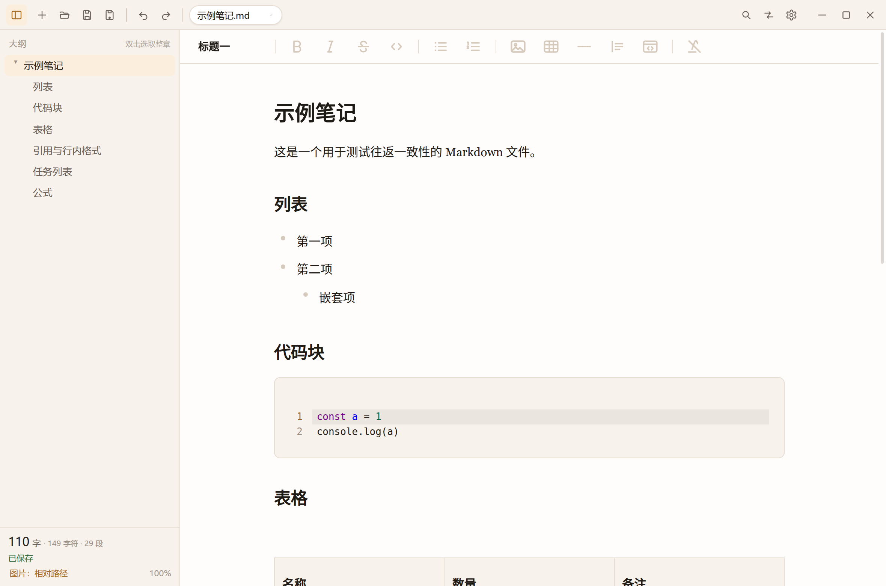
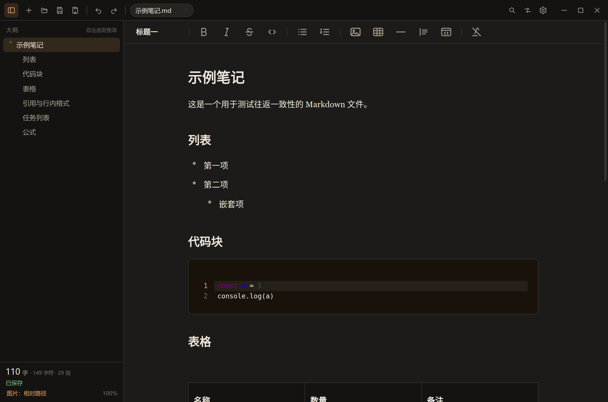

# seekie-write

类 Typora 的所见即所得 Markdown 编辑器。Electron 45 + Milkdown Crepe 7.23。




## 现在能做什么

- **所见即所得编辑**：Milkdown Crepe 内核，表格 / 代码块（CodeMirror）/ 公式（KaTeX）/ 任务列表 / 图片块齐全
- **顶部工具栏**：Crepe TopBar（默认关闭的特性，这里显式打开），纯图标 + 鼠标悬浮提示，分组为
  `段落·标题一~六` │ `粗体 斜体 删除线 行内代码` │ `项目符号 有序列表` │ `插入图片 表格 分割线 引用 代码块` │ `清除格式`
- **自定义标题栏**（Linux 优先，`frame:false`）：新建 / 打开 / 保存 / 另存为、撤销 / 重做、标签条；查找 / 替换 / 设置收在窗口按钮左侧
- **标签条**：用满标题栏剩余宽度；标签多到放不下时，右侧出现「全部标签」下拉，可直接切换或关闭任意标签
- **标签右键菜单**：关闭标签 / 关闭其他标签 / 关闭右侧标签、复制文件路径、在文件夹中显示
- **对话框记忆**：打开 / 保存对话框默认回到上次所在目录
- **大纲底部信息区**：字数 / 选中 / 字符 / 段落 / 保存状态 / 图片策略 / 缩放都收在大纲侧栏底部，不占窗口底部的横向空间
- **查找替换**：`Ctrl+F` / `Ctrl+H`，命中项用 ProseMirror Decoration 高亮，支持上一个/下一个、区分大小写、全部替换
- **设置面板**：外观（跟随系统 / 浅色 / 深色）、Crepe 主题（跟随应用 / Frame / Classic / Nord）、正文宽度、字体与字号；改完立即生效并持久化
- **正文右键菜单**：撤销 / 重做、剪切 / 粘贴、全选、插入图片 / 表格 / 分割线、清除格式、查找 / 替换；选中文字后可复制为纯文本 / Markdown / 富文本
- **可调宽大纲**：拖动右侧分隔条 170–420px，双击恢复 240px，宽度写入设置
- **窄窗口适配**：编辑区变窄时，Crepe 左侧的 +/拖动控件会自动让位，不会被裁到可视范围外
- **多标签页**：一个 ProseMirror view + 多份 EditorState，切标签保留撤销栈、选区、滚动位置
- **自动保存**：800ms debounce；没有落盘路径的标签只写草稿区（不会弹另存为），关窗口重开能恢复
- **冲突检测**：同一标签保存串行化，mtime 基线随保存结果直接带回，避免自己的自动保存误报；真正的外部修改仍会暂停并提示
- **打开非 Markdown 文档**：`@firecrawl/anydoc` 本地转换（Word / PPT / Excel / OpenDocument / RTF / EPUB / CSV / PDF）
- **另存命名**：`季度报告.docx` → `季度报告.docx.md`（保留原扩展名，不覆盖源文件）
- **图片两种保存策略**：内联 base64 / 相对路径（`文档名.assets/`）
- **大纲侧栏**：单击滚动到标题（自动避开 sticky TopBar），**双击选中整章**（大纲底部的"选中字数"立刻变成该章字数）

## 开发

```bash
npm install
npm run dev          # 开发模式（HMR）
npm run build        # 打 out/
npm run typecheck    # 主进程 + 渲染层分别做类型检查
npm run dist         # Linux AppImage + deb
```

Linux 上跑无边框窗口需要的系统库：

```bash
sudo apt install libnss3 libatk1.0-0 libatk-bridge2.0-0 libcups2 libgtk-3-0 \
  libxdamage1 libxkbcommon0 libasound2 libatspi2.0-0 libgbm1 libxrandr2 libxcomposite1
```

Wayland 会话下若拖拽区失效，用 `--ozone-platform=wayland` 启动；X11 下直接用默认即可。

## 快捷键

| 操作 | 快捷键 |
| --- | --- |
| 新建 / 打开 / 保存 | `Ctrl+N` / `Ctrl+O` / `Ctrl+S` |
| 另存为 | `Ctrl+Shift+S` |
| 关闭标签 | `Ctrl+W` |
| 撤销 / 重做 | `Ctrl+Z` / `Ctrl+Shift+Z` |
| 查找 / 替换 | `Ctrl+F` / `Ctrl+H` |
| 设置 | `Ctrl+,` |
| 段落 / 标题一 / 二 / 三 | `Ctrl+0` / `Ctrl+1` / `Ctrl+2` / `Ctrl+3` |
| 清除格式 | `Ctrl+\` |
| 切换侧栏 | `Ctrl+Shift+B` |
| 缩放 | `Ctrl+=` / `Ctrl+-` / `Ctrl+Shift+0` |

## 目录结构

```
electron/
  main.ts              窗口、菜单、IPC、seekie-asset:// 协议、关闭前握手
  preload.ts           contextBridge 白名单（渲染层没有 fs 能力）
  lib/
    anydoc.ts          anydoc 转换 + Document 模型 → Markdown（含图片占位注入）
    files.ts           打开 / 原子写 / 图片重写 / mtime 冲突检测
    drafts.ts          草稿区 + session.json 会话恢复
    assetStore.ts      内存资源仓库（图片字节，保存时才落盘）
    settings.ts        settings.json
src/
  App.tsx              标签生命周期、自动保存、菜单命令、会话恢复
  editor/
    createEditor.ts    Crepe 唯一实例
    topBarConfig.ts    TopBar 分组、按钮、清除格式命令、tooltip
    insert.ts          插入图片 / 表格 / 分割线
    searchPlugin.ts    查找命中高亮（ProseMirror Decoration）
    theme.ts           Crepe 主题切换 / 字体 / 正文宽度
    tabs.ts            单 view 多 state 的 TabStore
    session.ts         大纲 / 字数 / 选区统计（节流 120ms）
    icons.ts           工具栏描边图标
  lib/search.ts        纯文本查找（返回匹配位置）
  components/          TitleBar / Outline / SidebarFooter / FindBar / SettingsDialog / Overlays
shared/types.ts        main 与 renderer 共享类型
shared/defaults.ts     共享默认设置
samples/               测试用的 .docx / .md
```

## 已知限制

- **PDF 转换拿不到内嵌图片**：anydoc 对 PDF 直接产出 Markdown，没有 document 模型，也就没有 assets。文本型 PDF 可用，扫描版会提示需要 OCR（本机不做 OCR）。
- **Crepe TopBar 的自定义按钮不能加 class**：Crepe 只给 `.top-bar-item`，所以 tooltip 是靠挂载后补 `title` 实现的（`installTopBarTooltips`）。增删按钮或升级 Crepe 小版本后，要同步 `topBarConfig.ts` 里的 `BUTTON_LABEL_ORDER`。
- **`buildHeadingSelector` 未使用**：它没有从包入口导出，这里自己拼了 selector 结构，等价且不依赖半公开 API。
- **多标签共享一份 plugins**：个别插件的实例级瞬时状态（tooltip 是否展开等）在切标签时会被重置，文档内容、撤销栈、选区不受影响。

## 已验证的行为（Xvfb + CDP 自动化跑过）

| 场景 | 结果 |
| --- | --- |
| Crepe TopBar 出现、气泡工具栏不出现 | ✅ |
| 工具栏 12 个纯图标按钮 + tooltip，激活态跟随光标移动 | ✅ |
| 输入 → 字数（中西混排 31 字）/ 大纲实时更新 | ✅ |
| 双击大纲标题选中整章 → 标题栏"选中 N 字"同步 | ✅ |
| 打开 .docx（anydoc）→ 正文 + 大纲 + 内嵌图片显示 | ✅ 图片经 `seekie-asset://` 正常渲染 |
| 保存图片为相对路径 | ✅ 生成 `rel.assets/image-1.png`，md 写成 `./rel.assets/image-1.png` |
| 保存图片为 base64 | ✅ 写成 `data:image/png;base64,…` |
| 打开 .md → 表格 / 代码块 / 删除线 / 引用 / KaTeX 行内公式 | ✅ |
| 多标签切换 | ✅ 切回后内容与撤销栈都在 |
| 自动保存（800ms）到已有路径 | ✅ 文件内容更新 |
| 外部改文件 → 冲突检测 | ✅ 暂停自动保存 + 标签红框 + "重新载入 / 保留我的版本" |
| 关窗口前落盘草稿 | ✅ 写入 `userData/session.json` + `drafts/<tab>.md` |
| 深色主题 | ✅ 标题栏 / 大纲 / 编辑器 / 代码块同步切换 |
| 大纲底部信息区 | ✅ 字数 / 字符 / 段落 / 保存状态 / 图片策略 / 缩放合并显示，无底部横向状态栏 |
| 无路径标签自动保存 | ✅ 800ms 后写草稿区，不弹“另存为”；关闭标签会清理草稿 |
| 启动参数打开文件 | ✅ 只保留一个标签，不再多出空白标签 |
| 查找 / 替换 | ✅ 命中项高亮、`n/m` 计数、全部替换、撤销后恢复 |
| 设置面板 | ✅ 外观 / Crepe 主题 / 正文宽度 / 字体 / 字号实时生效，恢复默认正常 |
| TopBar 插入 | ✅ 图片（`seekie-asset://` 正常渲染）、3×3 表格、分割线、引用、代码块 |
| 标题栏新按钮 | ✅ 另存为 / 撤销 / 重做 / 查找 / 替换 / 设置，均有 tooltip |
| 启动文件拉取 | ✅ 渲染层就绪后主动取启动参数文件，生产构建打开准确 |
| 大纲单击 / 双击跳转 | ✅ 标题停在 TopBar 下方 16px，完整可见 |
| 标签条溢出 | ✅ 13 个标签时出现“全部标签”下拉，菜单 13 项，切换正常 |
| 自动保存冲突检测 | ✅ 连续 8 次输入触发自动保存无误报；外部追加修改仍会暂停并提示 |
| TopBar 图片图标 | ✅ 颜色加深到 `--fg`、线宽 2.1px |
| 大纲宽度拖动 | ✅ 240 → 330px 拖拽生效并持久化，双击恢复 240px |
| 窄窗口块级控件 | ✅ 760px 视口下 + 控件左边缘在编辑区内（248 vs 240） |
| 右键复制选中 | ✅ 纯文本 / Markdown（`**粗体**`）/ 富文本（`<strong>粗体</strong>`） |
| 标签右键菜单 | ✅ 关闭其他 → 剩 1 个；关闭右侧 → 剩 2 个；复制文件路径得到绝对路径 |
| 设置按钮位置 | ✅ 唯一按钮，位于窗口按钮左侧的 `titlebar__right` |
